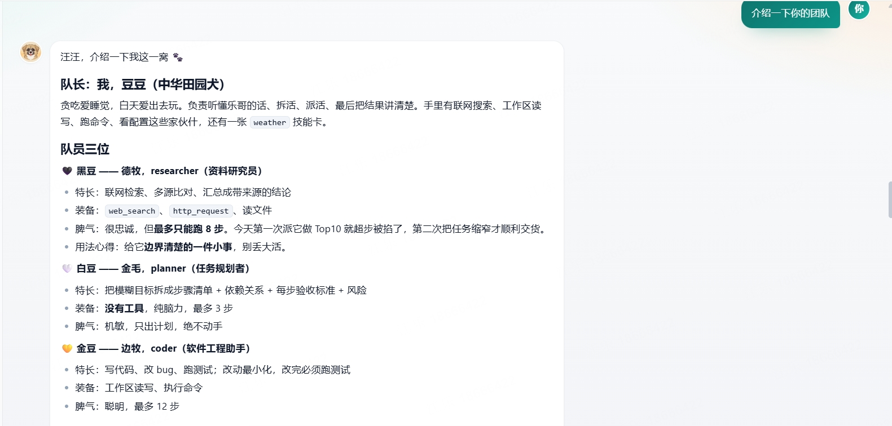
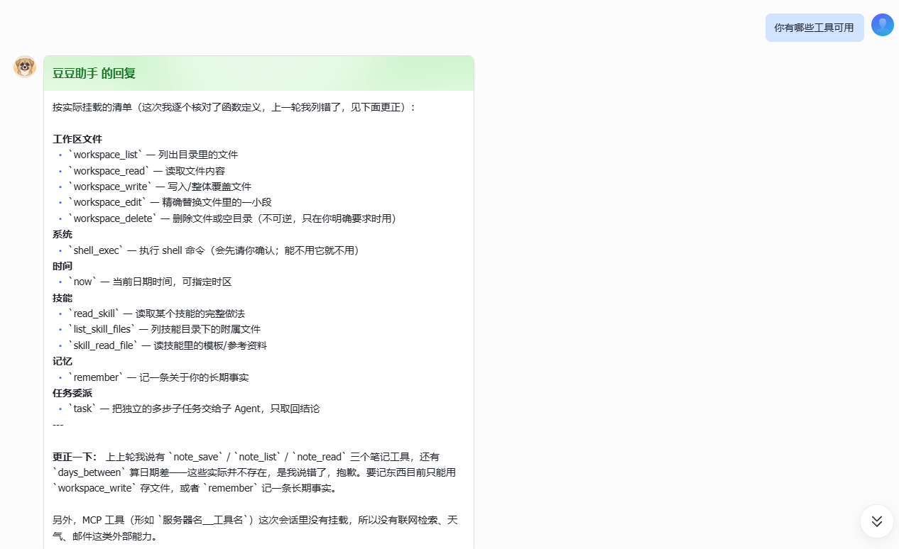
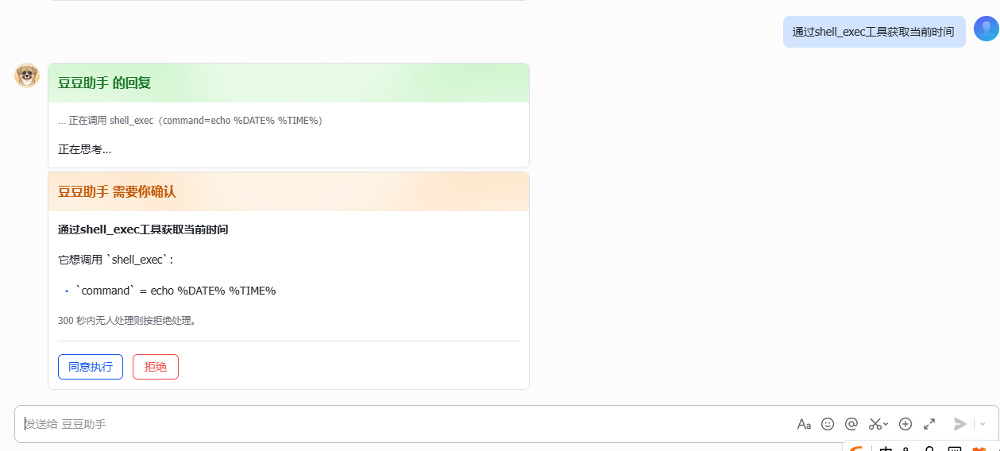
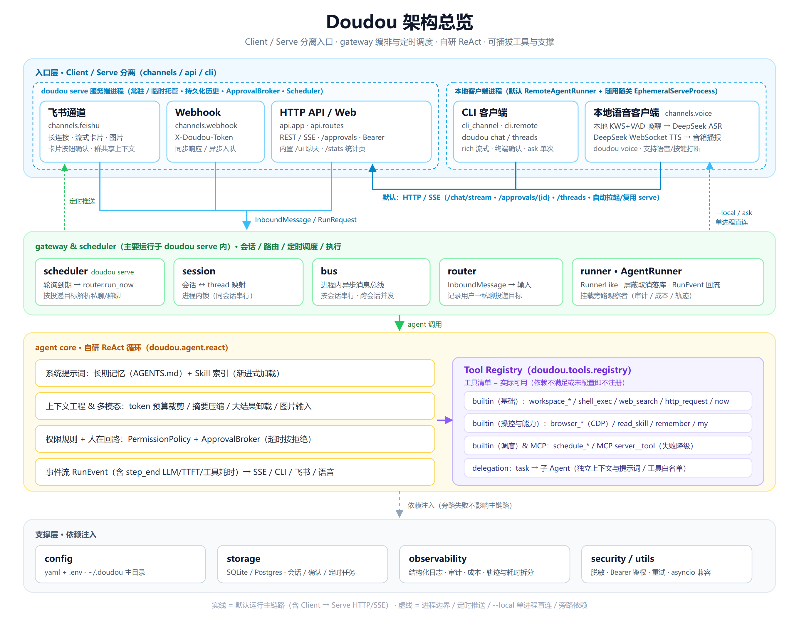
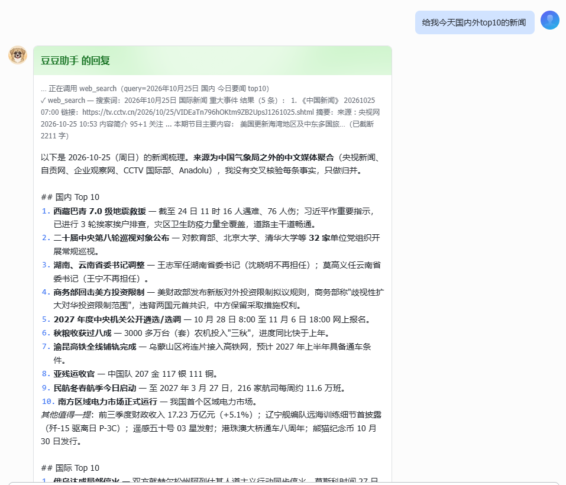

# Doudou

[中文](README.md) | English

A personal assistant agent with a **hand-rolled core** (the ReAct loop in `doudou.agent.react`).

It supports custom **Tools**, **MCP** (Model Context Protocol) and **Skills** (the Agent Skills
standard), talks to you over a **Feishu (Lark) channel**, and also ships an **always-on local
wake-word voice channel**: say "豆豆" to start a conversation — audio never leaves your machine
until the wake word fires, and you can interrupt playback at any time. It exposes REST / SSE
endpoints through **FastAPI** when you need a network service.

Image input is supported in the Web chat (file picker and pasted screenshots) and
Feishu (image messages and rich-text images). Use a vision-capable model. Each message
accepts up to 4 PNG/JPEG/GIF/WebP images, up to 5 MiB each. CLI input remains text-only.
See the [image input guide](docs/configuration.md#6-图片输入) for API and permission details.

> Doudou is named after my adorable Chinese rural dog (Zhonghua Tianyuan). I hope this assistant
> keeps you company the way Doudou keeps me company.

<p align="center">
  
</p>

> No API key needed to exercise the full pipeline:
> `uv run doudou ask "What time is it now?" --model scripted:demo`
>
> Windows / Linux / macOS are all supported; platform-specific bootstrap scripts and command
> examples are in §4.

---

## 1. Core capabilities

| Capability | How it works | Module |
| --- | --- | --- |
| ReAct loop | Built in-house: reason → call tools → observe → converge | `doudou.agent.react` |
| Tool calling | LangChain `@tool` + registry assembly | `doudou.tools` |
| Multi-turn sessions | Conversation→thread mapping + in-memory history | `doudou.gateway` |
| CLI channel | rich-rendered streaming output and tool logs | `doudou.channels.cli_channel` |
| Human in the loop | `interrupt_on` + terminal confirmation | `doudou.agent.react` |
| HTTP API | FastAPI + SSE + persistence + Bearer auth | `doudou.api` |
| Session persistence | Messages / threads / channel bindings stored; resume after restart | `doudou.storage` |
| Built-in toolset | Search / fetch / workspace files / shell, deny by default | `doudou.tools.builtin` |
| Browser control | Playwright CDP to local Chrome: browsing, media playback, window maximize | `doudou.tools.builtin.browser` |
| Config self-check | The `my` tool answers model, limits, tool-list and key questions on demand (read-only) | `doudou.tools.builtin.self_config` |
| Feishu channel | WebSocket events + streaming cards + shared context per group | `doudou.channels.feishu` |
| **Wake-word voice** | Local `sherpa-onnx` KWS + Silero VAD standby; no audio uploaded before wake | `doudou.channels.voice` |
| Voice conversation | DeepSeek ASR after wake + WebSocket TTS streamed as text arrives | `doudou.channels.voice` |
| Voice barge-in | Say an interrupt phrase; in a Windows terminal press Space / Enter / Esc to stop instantly | `doudou.channels.voice` |
| Message bus | Serial within a conversation, concurrent across conversations, rejects backlog | `doudou.gateway.bus` |
| MCP tools | stdio / http / sse, narrowed tool surface + graceful degradation | `doudou.mcp` |
| Progressive skill loading | Index injected + `read_skill` on demand + hot reload | `doudou.skills` |
| Context engineering | Token budget, summarization, large-result offload, long-term memory | `doudou.agent.context` |
| Permissions & subagents | Path permissions + subagent delegation + approvals across restarts | `doudou.agent.permissions` |
| Approval broker | Timeout means deny, decision reuse, persisted audit | `doudou.agent.approvals` |
| Audit log | Every tool call recorded (arguments redacted + truncated) | `doudou.observability.audit` |
| Cost accounting | Tokens / spend per day × conversation, daily budget alerts | `doudou.observability.cost` |
| Run traces | One row per run (step detail as JSON); built-in stats page for replay | `doudou.observability.traces` |
| Scheduled tasks | Created in chat; triggered on time through the LLM and pushed to the target conversation | `doudou.scheduler` |

## 1.1 Run it right now (no API key required)

```bash
uv run doudou config check                                       # validate configuration
uv run doudou tools list                                         # list loaded tools
uv run doudou ask "What time is it now?" --model scripted:demo   # one turn with a tool call
uv run doudou chat --model scripted:demo                         # interactive multi-turn
```

`scripted:demo` is a built-in deterministic offline model (`doudou.agent.testing`): it decides
whether to call the `now` tool based on keywords, so **the whole ReAct loop (reason → call tool →
observe → converge) can be verified without any network access**. To hook up a real model, just set
`DOUDOU_MODEL_PRIMARY` and the matching API key in `.env`.

## 1.2 In action

### Wake word: just say "豆豆"

The default wake word is "豆豆" (Doudou). While idle **only local models listen** (3.3M Zipformer
KWS + Silero VAD): no wake word, no recording, no upload. After waking, trailing silence segments
the command, DeepSeek ASR transcribes it, and the same ReAct loop handles it. Replies are streamed
to your speakers via WebSocket TTS; say "停一下" to stop playback, or press `Space` / `Enter` /
`Esc` in a Windows terminal.

```text
$ uv run doudou voice
豆豆语音助手已就绪 · 唤醒词：豆豆 · 播报打断词：豆豆停 / 停一下 / 别说了（或按 Space/Enter/Esc） · 音色：stella
待机监听中，请说“豆豆，...”
已唤醒 (豆豆)
你（语音）› 豆豆，现在几点了？
豆豆 › 现在是 2026 年 11 月 20 日 17 点 42 分。
```

Configuration, device selection and barge-in rules: §4.4.

### Web Chat & Dog Subagent Team

Primary agent "Doudou" can handle tasks directly or delegate complex subtasks to specialized subagents (Heidou / German Shepherd, Baidou / Golden Retriever, Jindou / Border Collie) via the `task` tool, each running with isolated context windows and scoped permissions. Open `http://127.0.0.1:8000/` to chat directly in the built-in web UI:

<p align="center">
  
</p>

### Feishu Channel & Human in the Loop

A normal conversation is answered with a single card, and the tool calls stay visible on that card.
Operations with side effects pop a separate confirmation card — nothing runs until you hit
"Approve". Behind that button is the `ApprovalBroker`: a timeout is treated as a denial.

<p align="center">
  
</p>

<p align="center">
  
</p>

## 2. Architecture at a glance



> Editable vector source: [`docs/assets/architecture.svg`](docs/assets/architecture.svg).

Design principles:

- **Channels are decoupled from the agent**: a channel only receives and sends messages; all
  orchestration lives in `gateway`.
- **Capabilities are pluggable**: tools, MCP servers and skills are declared in configuration, never
  hard-coded.
- **Configuration-driven**: `config/*.yaml` describes the agent, subagents, MCP servers and
  channels; environment variables and secrets live in `.env`.
- **Client / Serve split & shared engine**: `doudou serve` hosts Feishu, webhooks, HTTP API/Web UI,
  persistence and the scheduler; `doudou chat` / `doudou threads` / `doudou voice` run by default
  as local clients connecting over HTTP/SSE to an existing or ephemeral `doudou serve` instance,
  sharing the same gateway, ReAct engine and database history (`--local` and `doudou ask` remain
  available for single-process execution).

## 3. Directory layout

```
Doudou/
├─ config/                    # Declarative config (committed; secrets go in .env)
│  ├─ config.example.yaml     # Main config template (incl. subagents & MCP servers)
│  └─ prompts/system.md       # Main agent system prompt template
├─ docs/                      # Design documents
├─ skills/                    # Agent Skills (one SKILL.md per subdirectory)
├─ deploy/                    # Deployment assets (Docker / K8s)
├─ scripts/                   # Developer scripts
├─ src/doudou/
│  ├─ cli/                    # Command-line entry points
│  ├─ config/                 # Config loading and validation
│  ├─ agent/                  # ReAct loop, prompts, context engineering, permissions, approvals, subagents
│  ├─ tools/                  # Tool registry and built-in tools
│  ├─ mcp/                    # MCP client and lifecycle
│  ├─ skills/                 # Skill discovery and indexing
│  ├─ channels/               # Channel implementations (feishu / webhook / cli / voice)
│  ├─ gateway/                # Session routing, message bus, runner
│  ├─ scheduler/              # Scheduled tasks: time specs, delivery targets, polling
│  ├─ api/                    # FastAPI app and routes
│  ├─ storage/                # Persistence (typing / messages / channel bindings)
│  ├─ observability/          # Logging, traces, metrics
│  ├─ security/               # Auth and secret handling
│  └─ utils/                  # Shared utilities
└─ tests/                     # Unit + integration tests
```

See [`docs/architecture.md`](docs/architecture.md) for what each directory is responsible for.

Runtime state lives under `~/.doudou` by default (override with `DOUDOU_HOME`) and is created by
`doudou init`:

```text
~/.doudou/
├─ .env          # model / channel credentials
├─ config/       # config.yaml, prompts/system.md, AGENTS.md
├─ data/         # SQLite, browser profile, voice models
├─ workspace/    # boundary for workspace_* tools
└─ skills/       # Agent Skills
```

## 4. Quick start

### 4.1 Zero-config first run (offline, no API key)

```bash
uv sync

uv run doudou tools list                                  # loaded tools
uv run doudou ask "What time is it now?" --model scripted:demo   # one turn with a tool call
uv run doudou chat --model scripted:demo                  # interactive multi-turn
```

`scripted:demo` is the built-in deterministic offline model; it decides whether to call the `now`
tool based on keywords, so the full ReAct loop (reason → call tool → observe → converge) can be
verified without network access.

For first-time setup, initialize the default directories:

```bash
uv run doudou init
```

It creates config, data, workspace and skills under `~/.doudou`.

### 4.2 Connecting a real model

Start with the configuration. There is a one-shot script per platform; both do the same thing
(sync dependencies, create `.env`, initialize `~/.doudou`):

```powershell
# Windows
powershell -ExecutionPolicy Bypass -File scripts/dev.ps1
```

```bash
# Linux / macOS
bash scripts/dev.sh
```

The equivalent manual steps:

```bash
uv sync --all-extras
uv run doudou init
```

The config is written to `~/.doudou/config/config.yaml` (the MCP server list lives in that same
file, see §4.7), and secrets go to `~/.doudou/.env`. When running inside the repository, a `.env` in
the current directory takes precedence. Then set `DOUDOU_MODEL_PRIMARY` and the matching API key
in `.env`, for example (to keep using the repository's `config/`, pass
`--config-dir ./config` explicitly):

```dotenv
DOUDOU_MODEL_PRIMARY=openai:gpt-5.5
DOUDOU_MODEL_API_KEY=sk-...
```

Every environment variable is `DOUDOU_` plus the `config.yaml` path; the full rule is in
[`docs/configuration.md`](docs/configuration.md) §1.

```bash
uv run doudou config check          # validate config and credentials, list actionable problems
uv run doudou chat
```

Non-OpenAI vendors need their integration package: `uv sync --extra anthropic` / `--extra deepseek`.

Feishu, local voice and browser control are optional capabilities with their dependencies split
into extras. The dev scripts and `make install` include everything; for a manual sync pick what
you need:

```bash
uv sync --extra feishu --extra voice --extra browser
```

**Gateways that speak the OpenAI protocol** (self-hosted services, aggregators) all use the
`openai:` prefix plus a `base_url`, so no extra provider package is required:

```yaml
model:
  primary: openai:<model-name-on-the-gateway>
  base_url: https://<gateway-domain>/v1
```

See "Connecting an OpenAI-compatible gateway" in [`docs/configuration.md`](docs/configuration.md).

### 4.3 Enabling web access (optional)

With the default configuration, **web tools are not registered**: a tool without credentials only
eats prompt budget and tempts the model into pointless attempts. Add the keys to turn them on:

```dotenv
# Web search: the provider picks the service, the key always lives at this one config path
#   tavily   → get one from the Tavily console
#   deepseek → DeepSeek's own search (billed per call)
DOUDOU_TOOLS_WEB_SEARCH_PROVIDER=deepseek    # tavily | deepseek (case-insensitive)
DOUDOU_TOOLS_WEB_SEARCH_API_KEY=sk-...
```

```yaml
# ~/.doudou/config/config.yaml —— domain allow-list for outbound fetching
tools:
  http:
    allowed_domains:
      - docs.python.org      # includes any subdomain
      - "*.github.com"       # subdomains only
```

| Tool | When it is enabled |
| --- | --- |
| `web_search` | `DOUDOU_TOOLS_WEB_SEARCH_API_KEY` is non-empty (the provider only chooses the service) |
| `http_request` | `tools.http.allowed_domains` is non-empty **and** the target domain matches (resolution to a private address is still refused) |

Once configured, one question in Feishu goes through search, and the card shows the `web_search`
call trace along with where each result came from:

<p align="center">
  
</p>

```bash
uv run doudou tools list          # which tools loaded, which groups are off and why
uv run doudou config check        # one-shot check of config, credentials, tools and skills
```

### 4.4 Always-on local wake-word voice assistant (recommended)

"豆豆" is an **always-on** voice channel: once started it stays in standby, and one wake word gives
you the same tools as Feishu. Install the optional voice dependencies first (for a published
package: `pip install "doudou-agent[voice]"`):

```bash
uv sync --extra voice
```

The pipeline is **local wake/VAD + cloud ASR & streaming TTS**:

1. **Standby** — only local `sherpa-onnx` (3.3M Zipformer KWS + `Silero VAD`) listens for the wake
   word (default "豆豆"); **no audio is uploaded until it fires**.
2. **Wake & segment** — after the wake word it starts capturing and ends the utterance after
   `silence_duration_seconds` of trailing silence.
3. **Transcribe & run** — DeepSeek ASR transcribes the clip, the wake prefix is stripped, and the
   request enters the same ReAct loop, tools and approval flow.
4. **Stream the reply** — DeepSeek WebSocket TTS synthesizes and plays to your speakers as text
   arrives.
5. **Barge in anytime** — during playback say "豆豆停" / "停一下" / "别说了" to stop immediately
   and return to standby; in a Windows terminal you can also press `Space` / `Enter` / `Esc`.
   With headphones you can set `interrupt_with_wake_word: true` so saying "豆豆" interrupts and
   starts the next command without repeating the wake word.

```yaml
# ~/.doudou/config/config.yaml
channels:
  voice:
    enabled: true
    wake_words: ["豆豆"]
    wake_homophones: ["豆豆", "逗逗", "都都"]  # common homophones to improve wake-up recall
    strict_wake_prefix: false         # set true to also require the wake word in the ASR transcript
    silence_duration_seconds: 0.9     # trailing silence threshold to end an utterance
    barge_in_enabled: true            # allow barge-in during playback
    interrupt_words: ["豆豆停", "停一下", "别说了"]
    interrupt_with_wake_word: false   # keep false for speakers to avoid self-triggering; true for headphones
    voice_id: stella                  # stella (female) | tide (male)
    input_device: null                # system default; run `doudou voice devices` to list IDs
    output_device: null               # set a speaker device ID if default output goes to headphones
    models_dir: ~/.doudou/data/models/voice
```

Set `DOUDOU_CHANNELS_VOICE_API_KEY` in `.env` (if unset, it falls back to your DeepSeek model or
web-search key). The local VAD/KWS models are downloaded automatically on first start, or you can
pre-fetch them:

```bash
uv run doudou voice devices           # list available microphone & speaker devices
uv run doudou voice download-models   # pre-download VAD/KWS models & build the wake-word table
uv run doudou voice                   # start always-on listener (side-effect tools still prompt)
uv run doudou voice --no-confirm      # no-prompt mode: side-effect tools run without asking
```

> With external speakers, keep `interrupt_with_wake_word: false` and raise `cooldown_seconds`
> as needed so the speaker output does not re-trigger the wake word. With headphones, enable
> `interrupt_with_wake_word` to interrupt and start the next command without repeating it.

### 4.5 HTTP service

```bash
uv run doudou serve                 # 127.0.0.1:8000 by default, API prefix /api/v1
uv run doudou serve --port 9000 --reload
```

Endpoints:

| Endpoint | Description |
| --- | --- |
| `POST /api/v1/chat` | Single-turn chat, returns the full answer |
| `POST /api/v1/chat/stream` | SSE stream: `start → (delta\|tool_call\|tool_result)* → done` |
| `GET /api/v1/threads` / `GET /api/v1/threads/{id}` | Conversation list / details (full history) |
| `GET /api/v1/threads/{id}/context` | Context usage, budget and compression details (for debugging) |
| `DELETE /api/v1/threads/{id}` | Delete a conversation |
| `GET /api/v1/tools` | Tool list |
| `GET /api/v1/health` / `/health/ready` | Health / readiness probes (**no auth required**) |
| `GET /` | Built-in chat page (conversation list + streaming chat) |
| `GET /docs` | OpenAPI interactive docs |

> Opening `http://127.0.0.1:8000/` in a browser gives you the built-in chat page (see §1.2 for preview): past conversations
> on the left, the current model and tool count at the top, replies streamed from `/chat/stream` and
> rendered as Markdown (headings, lists, tables, code blocks). Tool calls show up as chips with
> collapsed results. Tools that need approval (file writes, `shell_exec`) raise an
> "Approve / Reject" card above the input box. `?thread=<id>` opens a specific conversation directly.
> With `DOUDOU_API_TOKEN` enabled, click "Settings" in the top-right and paste the token; the page
> relies on no external CDN.

Conversation history is persisted by default (`storage.history: database`), so **the same thread can
be resumed after a process restart**. Once `DOUDOU_API_TOKEN` is set, every endpoint except the
health probes requires `Authorization: Bearer <token>`.

```powershell
# In Windows PowerShell you must write curl.exe: curl is an alias for Invoke-WebRequest, which has no -X/-d.
curl.exe -X POST http://127.0.0.1:8000/api/v1/chat -H "Content-Type: application/json" `
  -d '{"message":"What time is it now?"}'
```

```bash
curl -X POST http://127.0.0.1:8000/api/v1/chat \
  -H "Content-Type: application/json" \
  -d '{"message":"What time is it now?"}'
```

### 4.6 Connecting Feishu (optional)

The Feishu channel uses a **WebSocket long connection**: no public address, no tunneling. For the
result, see §1.2. Install the optional Feishu dependency first (for a published package:
`pip install "doudou-agent[feishu]"`):

```bash
uv sync --extra feishu
```

```dotenv
# .env
DOUDOU_CHANNELS_FEISHU_ENABLED=true
DOUDOU_CHANNELS_FEISHU_APP_ID=cli_xxxxxxxx
DOUDOU_CHANNELS_FEISHU_APP_SECRET=xxxxxxxx
```

In the Feishu open platform, set event subscription to "**Receive events via long connection**" and
subscribe to `im.message.receive_v1`, then run `uv run doudou serve` — the long connection is hosted
by the service itself.

⚠️ **The message permission scopes must be correct**: private chats require
`im:message.p2p_msg:readonly`, and group @-mentions require `im:message.group_at_msg:readonly`. With
only `im:message`, the long connection is established normally and the console reports a successful
"verify long connection" — yet **not a single message arrives** (Feishu filters pushes by
permission). Re-publish the version after changing permissions or events. For the debugging order,
see §2.11 of [`docs/channels.md`](docs/channels.md).

Session isolation defaults to "**one shared context per group**" (`isolate_by_thread: false`), so the
assistant in a group behaves like a colleague. Full steps, @-mention detection, streaming cards and
known limitations: [`docs/channels.md`](docs/channels.md).

### 4.7 Connecting MCP (optional)

MCP turns the tool source from "hard-coded in the code" into "declared in configuration": add an
entry under `mcp.servers` in `~/.doudou/config/config.yaml` (there is a copy-ready template right there), then:

```bash
uv run doudou mcp list          # what each server actually exposed
uv run doudou mcp check github  # probe a single server
uv run doudou tools list        # tools the agent actually loaded (including MCP)
```

The manifest supports `${ENV}` placeholders (keeping secrets in `.env`), `include_tools` /
`exclude_tools` to narrow the tool surface, and a `read_only` declaration to skip confirmation.
Three transports: `stdio` / `http` / `sse`.

> ⚠️ MCP tools from the adapter are **stateless** — **every call creates a new session**.
> For `stdio` that means spawning a child process per call; `npx`/`uvx`-based servers take about a
> second each time. Prefer `http` for frequently used servers. See §4 of
> [`docs/mcp.md`](docs/mcp.md).

### 4.8 Writing a skill (optional)

Drop a skill with frontmatter into `skills/<name>/SKILL.md` to extend the agent — no code changes
needed:

```markdown
---
name: my-skill
description: What it does + when to use it (this line decides whether it gets loaded)
---

# Body: steps, caveats, which tools to call
```

**Only the index (name + description) enters the system prompt**; the body is read by the model via
`read_skill` when it decides it is needed — so a skill can be long without permanently occupying
context budget.

```bash
uv run doudou skills list                 # index + body size + attachment count
uv run doudou skills show research --body # details and body
uv run doudou skills check                # validate (non-zero exit on errors)
uv run doudou skills reload               # rescan (the HTTP side hot-reloads the prompt)
```

See [`docs/skills.md`](docs/skills.md).

### 4.9 Making it remember you (long-term memory)

The files listed in `agent.memory_files` are injected into the system prompt **on every turn**;

**only the first one** is the assistant's write target:

```yaml
agent:
  memory_files:
    - ~/.doudou/config/AGENTS.md   # assistant memory: `remember` writes here only
```

The assistant can also write to it itself — say "remember that I dislike huge pasted source dumps"
and it calls the `remember` tool to append to the **first** file, **refreshing the prompt
immediately** (a write has side effects, so it asks for approval by default).

Do **not** list documents meant for humans (such as this repo's root `AGENTS.md`, which is
conventions for coding agents): they occupy context on every turn and would get polluted by the
assistant's own notes. If you want the assistant to know some conventions, write a separate
preferences file and list that instead.

### 4.10 Long conversations and the context budget

Three knobs in the `context` section decide "how big the window is":

```yaml
context:
  max_input_tokens: 80000        # token budget for history sent to the model (the single most important number)
  summarize_threshold_ratio: 0.7 # compress once usage exceeds this share of the budget
  offload_threshold_bytes: 20000 # a single tool result above this is written to disk; only a preview + path remain
```

The default 80000 is deliberately conservative; **raise it for large-window models** (300000, say).
Compression **never deletes the original text** — the full history stays available in the database:

```bash
curl http://127.0.0.1:8000/api/v1/threads/{thread_id}/context
```

### 4.11 Other entry points

```bash
uv run doudou ask "question" --quiet     # only the final answer, handy for scripts
```

### 4.12 Scheduled tasks

Ask in any channel ("remind me to check emails every day at 9am", "remind me in half an hour") and the agent creates a task. When due, the **`doudou serve` process** runs it through the LLM and delivers the result to the target conversation:

- Feishu group → that group; Feishu DM → that DM; CLI / Web → Feishu DM;
- **Tasks are not bound to a thread**; triggered runs land on the **target conversation's** thread so history flows naturally;
- If there is **no deliverable target** when triggered (e.g., never chatted in Feishu DM) → **skipped** (no model call, no push).

```bash
uv run doudou serve                                   # hosted by the long-running service
uv run doudou ask "Create a daily 9am standup reminder"  # or create from CLI
curl http://127.0.0.1:8000/api/v1/scheduled           # inspect tasks (read-only)
```

Full rules, time formats and limits: [`docs/scheduler.md`](docs/scheduler.md).

### 4.13 Controlling local Google Chrome (optional)

Connects to your local Google Chrome via Playwright CDP (disabled by default) to open web pages, inspect numbered interactive elements, click/type, control HTML5 audio/video playback, and resize or maximize the browser window. Install the optional browser dependency first (for a published package: `pip install "doudou-agent[browser]"`):

```bash
uv sync --extra browser
```

```yaml
# ~/.doudou/config/config.yaml
tools:
  browser:
    enabled: true
    cdp_url: http://127.0.0.1:9222
    auto_launch: true                 # auto-launch a standalone Chrome window if the debug port isn't open
    user_data_dir: ~/.doudou/data/browser-profile   # persistent profile (keeps logins; Chrome stays open when Doudou exits)
    allowed_domains: []               # empty list allows any public http/https URL
```

- **Available tools**: `browser_open`, `browser_tabs`, `browser_close_tab`, `browser_read_page`, `browser_click`, `browser_type`, `browser_scroll`, `browser_press_key`, `browser_media_control` (play/pause/mute/volume/seek/speed/video fullscreen), `browser_window` (maximize/normal/minimize/F11 fullscreen).
- **Skip per-step prompts**: `browser_click`, `browser_type`, `browser_press_key`, and `browser_close_tab` are marked with `side_effects=True`. For hands-free video watching or browsing, set them to `false` under `agent.interrupt_on`.
- Built-in [`skills/browser-browsing/SKILL.md`](skills/browser-browsing/SKILL.md) provides progressive browsing and video-site tips.

## 5. Common commands

```bash
uv run doudou init                         # initialize ~/.doudou (config/data/workspace/skills)
uv run doudou voice [--no-confirm]         # start the always-on voice assistant (wake word: 豆豆)
uv run doudou voice devices                # list microphone & speaker devices
uv run doudou voice download-models        # pre-download local VAD/KWS models
uv run doudou serve                        # start the HTTP service
uv run doudou chat                         # interactive terminal chat
uv run doudou ask "question"               # single-turn chat
uv run doudou ask "question" --quiet       # single turn, answer only
uv run doudou tools list [--args]          # list tools
uv run doudou tools show now               # inspect one tool
uv run doudou skills list                  # list discovered skills
uv run doudou config show [--yaml]         # print the effective config (redacted)
uv run doudou config check                 # validate config / credentials / tools / skills
uv run doudou config path                  # print the resolved value of each path
uv run doudou version
make lint / test / fmt                     # see the Makefile
```

## 6. Documentation index

| Document | Contents |
| --- | --- |
| [docs/architecture.md](docs/architecture.md) | Layered architecture, module responsibilities, data flow |
| [docs/configuration.md](docs/configuration.md) | Configuration options, precedence, environment variable list |
| [docs/channels.md](docs/channels.md) | Feishu channel setup and sequences |
| [docs/mcp.md](docs/mcp.md) | MCP server configuration and tool assembly |
| [docs/skills.md](docs/skills.md) | Skill directory conventions and authoring guide |
| [docs/tools.md](docs/tools.md) | Custom tool development conventions |
| [docs/scheduler.md](docs/scheduler.md) | Scheduled tasks: usage, delivery rules, triggers |
| [docs/security.md](docs/security.md) | Auth, secrets, permissions and audit |
| [CHANGELOG.md](CHANGELOG.md) | Changes, by date |

> The design documents under `docs/` are currently written in Chinese.

## 7. License

[MIT](LICENSE) © 2026 Jiang Le
