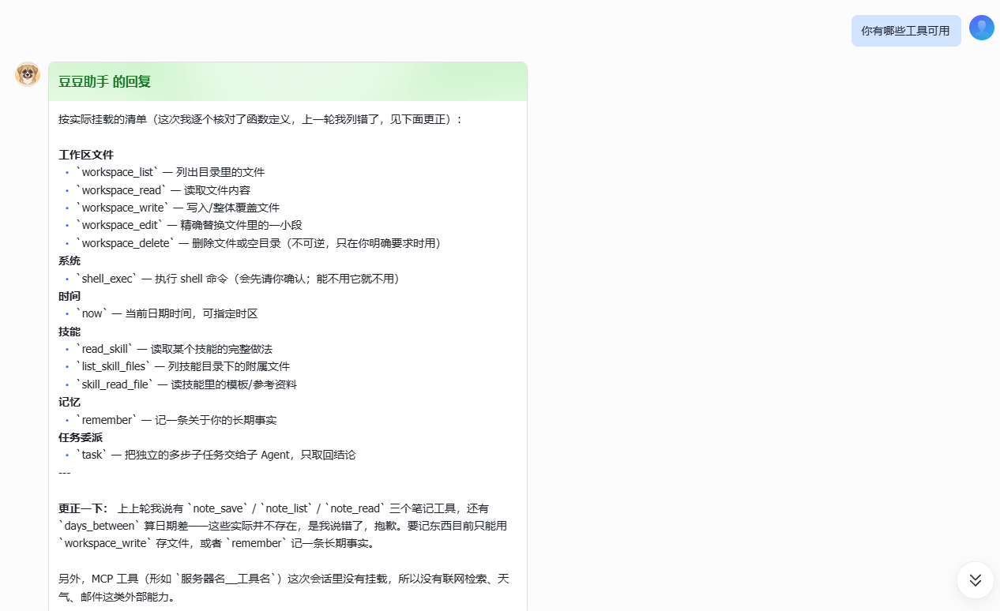
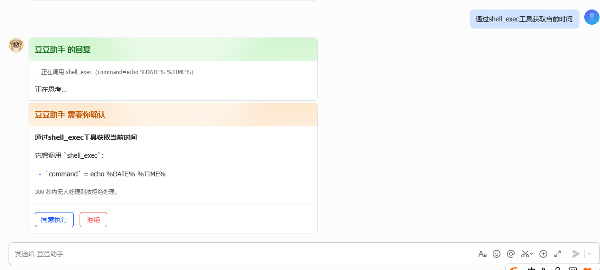
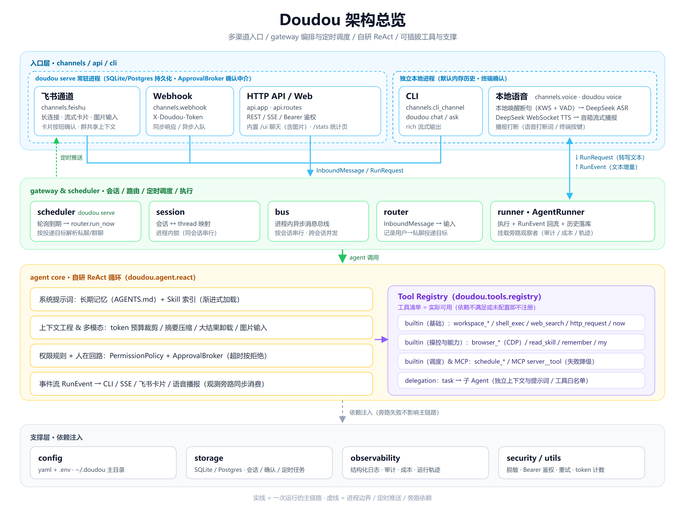
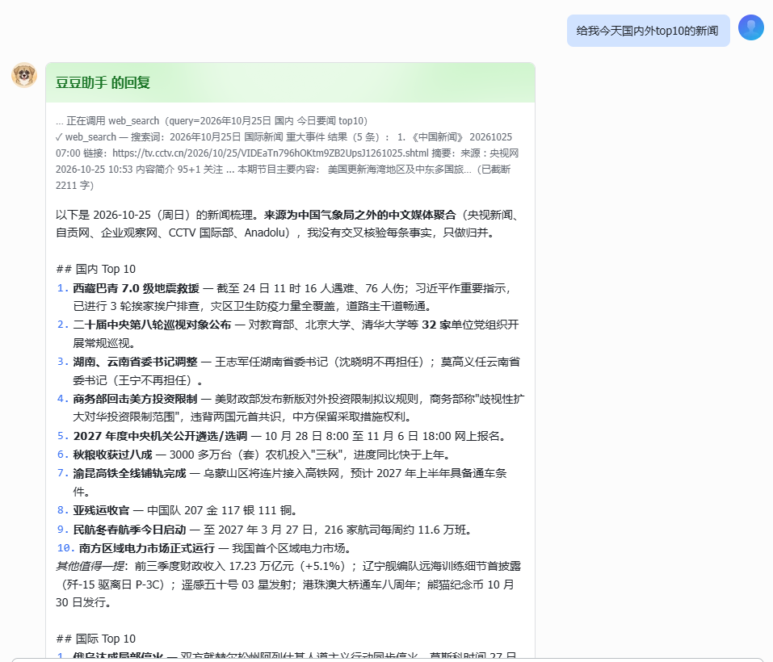

# Doudou

**内核自研**的个人助手 Agent（`doudou.agent.react` 的 ReAct 循环）。

支持自定义 **Tool**、**MCP**（Model Context Protocol）、**Skill**（Agent Skills 标准），
并通过**飞书（Lark）通道**与用户对话；需要网络服务时使用 **FastAPI** 对外暴露 REST / SSE 接口。

> 豆豆的名字来源于我家可爱的中华田园犬，我希望这个助手像我家豆豆一样陪伴大家。

<p align="center">
  
</p>

> 不需要 API Key 就能验证完整链路：`uv run doudou ask "现在几点了？" --model scripted:demo`
>
> Windows / Linux / macOS 都支持；两个平台的启动脚本与命令示例见 §4。

---

## 1. 核心能力

| 能力 | 实现方式 | 对应模块 |
| --- | --- | --- |
| ReAct 循环 | 自研：推理 → 工具调用 → 观察 → 收敛 | `doudou.agent.react` |
| 工具调用 | LangChain `@tool` + 注册表装配 | `doudou.tools` |
| 多轮会话 | 会话→thread 映射 + 内存历史 | `doudou.gateway` |
| CLI 通道 | rich 渲染流式输出与工具日志 | `doudou.channels.cli_channel` |
| 人在回路 | `interrupt_on` + 终端确认 | `doudou.agent.react` |
| HTTP API | FastAPI + SSE + 落库 + Bearer 鉴权 | `doudou.api` |
| 会话持久化 | 消息/线程/渠道绑定落库，重启可续 | `doudou.storage` |
| 实用工具集 | 检索 / 抓取 / 工作区文件 / 命令执行，默认拒绝 | `doudou.tools.builtin` |
| 飞书通道 | 长连接收事件 + 流式卡片 + 群里共享上下文 | `doudou.channels.feishu` |
| 消息总线 | 按会话串行、跨会话并发、积压拒绝 | `doudou.gateway.bus` |
| MCP 工具 | stdio / http / sse，工具面收敛 + 失败降级 | `doudou.mcp` |
| Skill 渐进式加载 | 索引注入 + `read_skill` 按需读 + 热重载 | `doudou.skills` |
| 上下文工程 | token 预算、摘要压缩、大结果卸载、长期记忆 | `doudou.agent.context` |
| 权限与子 Agent | 路径权限 + 子 Agent 委派 + 跨重启确认 | `doudou.agent.permissions` |
| 确认中介 | 超时按拒绝、决策复用、落库审计 | `doudou.agent.approvals` |
| 审计日志 | 工具调用全量留痕（参数打码 + 截断） | `doudou.observability.audit` |
| 成本核算 | 按天×会话的 token/费用、日预算告警 | `doudou.observability.cost` |
| 追踪 | Langfuse（可选，缺 key 则降级） | `doudou.observability.tracing` |

## 1.1 立刻可跑（不需要任何 API Key）

```bash
uv run doudou config check                                       # 校验配置
uv run doudou tools list                                         # 看已装载的工具
uv run doudou ask "现在几点了？" --model scripted:demo            # 跑一轮带工具调用的对话
uv run doudou chat --model scripted:demo                         # 交互式多轮
```

`scripted:demo` 是内置的确定性离线模型（`doudou.agent.testing`）：它会按关键词决定是否
调用 `now` 工具，因此**完整的 ReAct 循环（推理 → 工具调用 → 观察 → 收敛）无需联网即可验证**。
接入真实模型只需在 `.env` 里配好 `DOUDOU_MODEL__PRIMARY` 与对应 API Key。

## 1.2 效果预览（飞书）

日常对话直接回一张卡片，工具调用过程留在卡片上；碰到有副作用的操作会单独弹一张确认卡片，
点「同意执行」才真正执行 —— 确认按钮背后是 `ApprovalBroker`，超时按拒绝处理。

<p align="center">
  
</p>

<p align="center">
  
</p>

## 2. 架构总览



> 可编辑的矢量源文件：[`docs/assets/architecture.svg`](docs/assets/architecture.svg)。

设计原则：

- **通道与 Agent 解耦**：通道只负责「收消息 / 发消息」，所有编排逻辑集中在 `gateway`。
- **能力可插拔**：工具、MCP server、Skill 均通过配置声明，不写死在代码里。
- **配置驱动**：`config/*.yaml` 描述 Agent、子 Agent、MCP、通道；环境变量与密钥走 `.env`。
- **同一套 Agent 服务多渠道**：飞书、Webhook、CLI、HTTP API 共享同一个 Agent 实例。

## 3. 目录结构

```
Doudou/
├─ config/                    # 声明式配置（可提交，密钥放 .env）
│  ├─ config.example.yaml     # 主配置模板
│  ├─ mcp.servers.example.yaml# MCP server 清单模板
│  └─ agents.yaml             # 主 Agent 提示词 + 子 Agent 定义
├─ docs/                      # 设计文档
├─ skills/                    # Agent Skills（每个子目录一个 SKILL.md）
├─ deploy/                    # 部署相关（Docker / K8s）
├─ scripts/                   # 开发脚本
├─ src/doudou/
│  ├─ cli/                    # 命令行入口
│  ├─ config/                 # 配置加载与校验
│  ├─ agent/                  # ReAct 循环、提示词、上下文工程、权限、确认、子 Agent
│  ├─ tools/                  # 工具注册表与内置工具
│  ├─ mcp/                    # MCP 客户端与生命周期
│  ├─ skills/                 # Skill 发现与索引
│  ├─ channels/               # 通道实现（feishu / webhook / cli）
│  ├─ gateway/                # 会话路由、消息总线、运行器
│  ├─ api/                    # FastAPI 应用与路由
│  ├─ storage/                # 持久化（typing / 消息 / 通道绑定）
│  ├─ observability/          # 日志、链路追踪、指标
│  ├─ security/               # 鉴权与密钥处理
│  └─ utils/                  # 通用工具
└─ tests/                     # 单元 + 集成测试
```

各目录职责详见 [`docs/architecture.md`](docs/architecture.md)。

## 4. 快速开始

### 4.1 零配置先跑起来（离线，不需要 API Key）

```bash
uv sync

uv run doudou tools list                                  # 已装载的工具
uv run doudou ask "现在几点了？" --model scripted:demo      # 一轮带工具调用的对话
uv run doudou chat --model scripted:demo                   # 交互式多轮
```

`scripted:demo` 是内置的确定性离线模型，会按关键词决定是否调用 `now` 工具，
因此完整的 ReAct 循环（推理 → 工具调用 → 观察 → 收敛）无需联网即可验证。

### 4.2 接入真实模型

先准备配置。两个平台各有一键脚本，做的是同一件事（复制模板、建目录、同步依赖）：

```powershell
# Windows
powershell -ExecutionPolicy Bypass -File scripts/dev.ps1
```

```bash
# Linux / macOS
bash scripts/dev.sh
```

手工等价步骤：复制 `.env.example` → `.env`、`config/config.example.yaml` →
`config/config.yaml`；需要 MCP 时再复制 `config/mcp.servers.example.yaml` →
`config/mcp.servers.yaml`。

然后在 `.env` 里设置 `DOUDOU_MODEL__PRIMARY` 与对应的 API Key，例如：

```dotenv
DOUDOU_MODEL__PRIMARY=openai:gpt-5.5
OPENAI_API_KEY=sk-...
```

```bash
uv run doudou config check          # 校验配置与凭据，输出可操作的问题清单
uv run doudou chat
```

非 OpenAI 厂商需要装对应集成包：`uv sync --extra anthropic` / `--extra deepseek`。

**兼容 OpenAI 协议的网关**（自建服务、聚合平台）统一用 `openai:` 前缀 + `base_url`，
不需要额外的 provider 包：

```yaml
model:
  primary: openai:<网关上的模型名>
  base_url: https://<网关域名>/v1
```

详见 [`docs/configuration.md`](docs/configuration.md) 的「接入兼容 OpenAI 协议的网关」。

### 4.3 开启联网能力（可选）

默认配置下**联网工具不注册**：没有凭据的工具只会占提示词、诱导模型乱试。
想启用就补上对应的钥匙：

```dotenv
# 联网检索：二选一（provider 决定用哪个 key）
#   tavily   → TAVILY_API_KEY=tvly-...
#   deepseek → DEEPSEEK_API_KEY=sk-...   （DeepSeek 自研搜索，按次计费）
DEEPSEEK_API_KEY=sk-...
```

```yaml
# config/config.yaml —— 搜索 provider 与出站抓取的域名白名单
tools:
  web_search:
    provider: deepseek        # tavily | deepseek（大小写不敏感）
    max_results: 5
  http:
    allowed_domains:
      - docs.python.org      # 含任意子域
      - "*.github.com"       # 只含子域
```

| 工具 | 启用条件 |
| --- | --- |
| `web_search` | 当前 provider 对应的 key 非空（默认 `tavily` → `TAVILY_API_KEY`；`deepseek` → `DEEPSEEK_API_KEY`） |
| `http_request` | `tools.http.allowed_domains` 非空，且目标域名命中（解析到内网地址也会被拒） |

配置好之后，在飞书里问一句就会走搜索，卡片上能看到 `web_search` 的调用痕迹与结果来源：

<p align="center">
  
</p>

```bash
uv run doudou tools list          # 看哪些工具已装载、哪些分组未启用及原因
uv run doudou config check        # 一次性检查配置、凭据、工具与 Skill
```

### 4.4 HTTP 服务

```bash
uv run doudou serve                 # 默认 127.0.0.1:8000，接口前缀 /api/v1
uv run doudou serve --port 9000 --reload
```

启动后：

| 接口 | 说明 |
| --- | --- |
| `POST /api/v1/chat` | 单轮对话，一次返回完整答复 |
| `POST /api/v1/chat/stream` | SSE 流式：`start → (delta\|tool_call\|tool_result)* → done` |
| `GET /api/v1/threads` / `GET /api/v1/threads/{id}` | 会话列表 / 会话详情（含完整历史） |
| `GET /api/v1/threads/{id}/context` | 上下文占用、预算与压缩明细（排查用） |
| `DELETE /api/v1/threads/{id}` | 删除会话 |
| `GET /api/v1/tools` | 工具清单 |
| `GET /api/v1/health` / `/health/ready` | 健康 / 就绪检查（**不需要鉴权**） |
| `GET /` | 内置聊天页（会话列表 + 流式对话） |
| `GET /docs` | OpenAPI 交互文档 |

> 浏览器直接打开 `http://127.0.0.1:8000/` 就是内置聊天页：左侧是历史会话，顶部显示
> 当前模型与工具数，回复走 `/chat/stream` 流式输出；需要确认的工具（写文件、`shell_exec`）
> 会在输入框上方弹出「同意 / 拒绝」卡片。开启 `DOUDOU_API_TOKEN` 后，点右上角「设置」
> 填入令牌即可；页面不依赖任何外部 CDN。

会话历史默认落库（`storage.history: database`），**进程重启后同一 thread 仍可续聊**。
设置 `DOUDOU_API_TOKEN` 后，除健康检查外的接口都要求
`Authorization: Bearer <token>`。

```powershell
# Windows PowerShell 里要写 curl.exe：curl 是 Invoke-WebRequest 的别名，没有 -X/-d。
curl.exe -X POST http://127.0.0.1:8000/api/v1/chat -H "Content-Type: application/json" `
  -d '{"message":"现在几点了？"}'
```

```bash
curl -X POST http://127.0.0.1:8000/api/v1/chat \
  -H "Content-Type: application/json" \
  -d '{"message":"现在几点了？"}'
```

### 4.5 接入飞书（可选）

飞书通道用 **WebSocket 长连接**，不需要公网地址、不需要内网穿透；接入后的效果见 §1.2。

```dotenv
# .env
DOUDOU_CHANNELS__FEISHU__ENABLED=true
FEISHU_APP_ID=cli_xxxxxxxx
FEISHU_APP_SECRET=xxxxxxxx
```

飞书开放平台里把事件订阅设为「**使用长连接接收事件**」并订阅
`im.message.receive_v1`，然后 `uv run doudou serve` —— 长连接随服务一起托管。

⚠️ **消息类权限必须开对**：私聊要 `im:message.p2p_msg:readonly`，群里 @ 要
`im:message.group_at_msg:readonly`。只开 `im:message` 的话，长连接会正常建立、
控制台「验证长连接」也会显示成功，但**一条消息都收不到**（飞书按权限过滤推送）。
权限/事件改完记得重新发布版本。排查顺序见
[`docs/channels.md`](docs/channels.md) 的 §2.11。

会话隔离默认是「**同一个群共享一个上下文**」（`isolate_by_thread: false`），
群里的助手像一个同事。完整步骤、@ 判定、卡片流式与已知限制见
[`docs/channels.md`](docs/channels.md)。

### 4.6 接入 MCP（可选）

MCP 让工具来源从「写死在代码里」变成「配置声明」：

```bash
cp config/mcp.servers.example.yaml config/mcp.servers.yaml   # Windows 用 Copy-Item
uv run doudou mcp list          # 看每个 server 拉到了什么
uv run doudou mcp check github  # 单独探测一个
uv run doudou tools list        # Agent 实际装载的工具（含 MCP）
```

清单支持 `${ENV}` 占位（密钥留在 `.env`）、`include_tools` / `exclude_tools`
收敛工具面、`read_only` 声明免确认。三种 transport：`stdio` / `http` / `sse`。

> ⚠️ 适配器的 MCP 工具是**无状态**的 —— **每次调用都会新建 session**。
> 对 `stdio` 就是每次调用重新拉起子进程，`npx`/`uvx` 那类会到秒级；
> 需要频繁调用优先用 `http`。详见 [`docs/mcp.md`](docs/mcp.md) §4。

### 4.7 编写 Skill（可选）

在 `skills/<name>/SKILL.md` 写一个带 frontmatter 的技能即可扩展能力，
无需改代码：

```markdown
---
name: my-skill
description: 做什么 + 什么时候用（这句决定它会不会被加载）
---

# 正文：步骤、注意事项、该调用哪些工具
```

**只有索引（name + description）会进系统提示词**；正文由模型判断需要时调
`read_skill` 读取 —— 所以技能可以写得很长，不会一直占着上下文预算。

```bash
uv run doudou skills list                 # 索引 + 正文大小 + 附件数
uv run doudou skills show research --body # 看详情与正文
uv run doudou skills check                # 校验（有错则非零退出）
uv run doudou skills reload               # 重新扫描（HTTP 侧会热更新提示词）
```

详见 [`docs/skills.md`](docs/skills.md)。

### 4.8 让它记住你（长期记忆）

`agent.memory_files` 指向的文件会**每轮**注入系统提示词：

```yaml
agent:
  memory_files:
    - AGENTS.md          # 默认；指向你自己的偏好文件也可以
```

助手也能自己记 —— 说「记住我不喜欢大段贴原文」时它会调用 `remember` 工具追加到该文件，
**并立刻刷新提示词**（写操作有副作用，默认需要确认）。

### 4.9 长会话与上下文预算

三个旋钮在 `context` 段，决定「窗口有多大」：

```yaml
context:
  max_input_tokens: 80000        # 送进模型的历史 token 预算（最关键的一个数）
  summarize_threshold_ratio: 0.7 # 用量超过预算这个比例时压缩
  offload_threshold_bytes: 20000 # 单条工具结果超过它落盘，只留预览 + 路径
```

默认 80000 刻意保守；**100 万上下文的大模型应该调高**（例如 300000）。
压缩**不会删除原文** —— 库里的完整历史始终可用：

```bash
curl http://127.0.0.1:8000/api/v1/threads/{thread_id}/context
```

### 4.10 其他入口
```bash
uv run doudou ask "问题" --quiet     # 只输出最终答复，便于脚本调用
```

飞书接入步骤见 [`docs/channels.md`](docs/channels.md)，MCP 接入见 [`docs/mcp.md`](docs/mcp.md)，
Skill 编写见 [`docs/skills.md`](docs/skills.md)。

## 5. 常用命令

```bash
uv run doudou serve                        # 启动 HTTP 服务
uv run doudou chat                         # 终端交互式对话
uv run doudou ask "问题"                    # 单轮对话
uv run doudou ask "问题" --quiet            # 单轮，只输出答复
uv run doudou tools list [--args]          # 列出工具
uv run doudou tools show now               # 查看单个工具
uv run doudou skills list                  # 列出已发现 Skill
uv run doudou config show [--yaml]         # 打印生效配置（脱敏）
uv run doudou config check                 # 校验配置/凭据/工具/Skill
uv run doudou config path                  # 打印各路径的实际取值
uv run doudou version
make lint / test / fmt                     # 见 Makefile
```

## 6. 文档索引

| 文档 | 内容 |
| --- | --- |
| [docs/architecture.md](docs/architecture.md) | 分层架构、模块职责、数据流 |
| [docs/configuration.md](docs/configuration.md) | 配置项、优先级、环境变量清单 |
| [docs/channels.md](docs/channels.md) | 飞书通道接入与时序 |
| [docs/mcp.md](docs/mcp.md) | MCP server 配置与工具装配 |
| [docs/skills.md](docs/skills.md) | Skill 目录规范与编写指引 |
| [docs/tools.md](docs/tools.md) | 自定义工具开发规范 |
| [docs/security.md](docs/security.md) | 鉴权、密钥、权限与审计 |
| [CHANGELOG.md](CHANGELOG.md) | 按日期记录的变更 |

## 7. 许可证

[MIT](LICENSE) © 2026 Jiang Le
